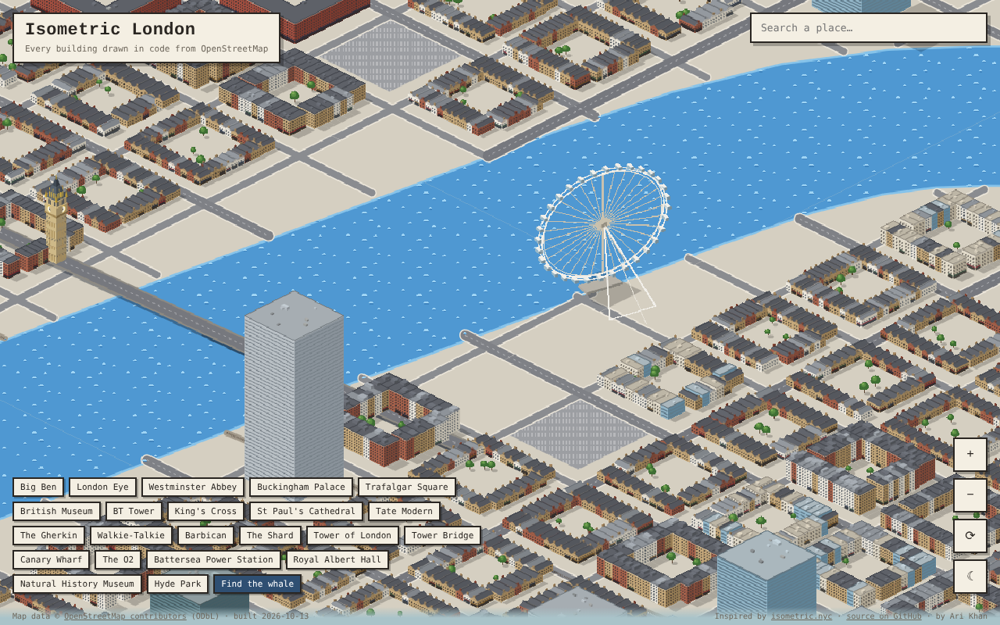

# Isometric London

A giant isometric pixel-art map of central London, roughly Zones 1–2. Every building, road, park and stretch of the Thames is drawn in code from OpenStreetMap data, with no AI-generated images and no map tiles. London's most famous buildings are hand-modelled, and a whale swims up and down the Thames.

Inspired by [isometric.nyc](https://cannoneyed.com/isometric-nyc/).



## Features

- Pan, zoom and pinch over hundreds of thousands of buildings, streamed in 500 m chunks
- 27 hand-built landmarks, including Big Ben, the London Eye, St Paul's, the Shard, the Gherkin, Tower Bridge, Battersea Power Station and the O2
- Windows on every floor, pitched and hipped roofs with chimneys, roof plant on flat roofs, domes, courtyards and shadows
- Animated pixel waves on the Thames, the docks and every lake, and a whale you can find with one click
- Rotate the city in 90° steps to see around tall buildings (`R`)
- Day and night modes, with lit windows, street lamps and aircraft lights on towers (`N`)
- Search for named places, or jump to landmarks like the Shard, St Paul's and Canary Wharf
- Shareable links: the URL keeps your position, zoom and rotation

## How it works

**1. Fetch** (`scripts/fetch.mjs`)
Splits the area in `config.json` into a grid and downloads buildings, building parts, coastline, water, land use, parks, parking, piers, roads, railways and mapped trees from the [Overpass API](https://overpass-api.de). The download can be resumed and retries with backoff across mirror servers.

**2. Build** (`scripts/build.mjs`)
- Projects coordinates to local metres.
- Builds the tidal Thames from OpenStreetMap's coastline, which maps it as sea rather than as a water area.
- Joins multipolygon relations into rings, keeping courtyards as holes.
- Replaces building outlines with their detailed building parts where they exist.
- Estimates each building's height and roof from its tags, or from its type when those are missing.
- Assigns each building a material: red brick, London stock brick, Portland stone, stucco, glass, concrete, Gothic stone, terracotta, brutalist concrete, metal or church.
- Places each landmark model on its OpenStreetMap building (matched by name) and removes the plain block it replaces.
- Clips land use, parks and water to each chunk, scatters trees through parks, and writes compact JSON chunks using 0.5 m integer coordinates.

**3. Render** (`public/iso.js`, `public/landmarks.js`)
A Canvas 2D renderer with no dependencies:
- Extrudes building footprints into 2:1 isometric blocks, culls hidden walls and shades the rest by direction.
- Draws windows floor by floor, sized in metres, with shopfronts, cornices, lit windows at night, pitched and hipped roofs, chimneys and roof plant.
- Renders the landmarks from small 3D models made of lit, depth-sorted polygons.
- Depth-sorts everything with the painter's algorithm.

Each chunk is painted once into off-screen bitmaps:
- Ground, water mask, bridges and buildings are separate layers, cached per level of detail, rotation and day/night mode within a memory budget.
- Panning only copies pixels, and zooming out swaps to lower-resolution bitmaps.
- Water gets an animated wave pattern every frame, masked to the water, and the whale is drawn between the waves and the bridges.

## Run it locally

You need Node 18 or newer.

```bash
npm run sample   # builds a small fake neighbourhood, which takes seconds
npm run serve    # then open http://localhost:8000
```

To build the real London map:

```bash
rm -rf cache/raw          # remove the sample
npm run fetch             # downloads about 28 areas of OpenStreetMap data, 30–60 min
npm run build
npm run serve
```

## Deploy to GitHub Pages

1. Push this repo to GitHub.
2. Go to **Settings → Pages → Build and deployment** and set **Source** to **GitHub Actions**.
3. Go to **Actions → Build and deploy map → Run workflow**.

The workflow downloads the data, builds the chunks and publishes the site. The download is cached between runs, and if a run stops part-way the next one carries on from where it got to. Changing `config.json` or `scripts/fetch.mjs` starts a fresh download.

## Map another city

Change `bbox`, `start`, `landmarks` and `thames` (the whale's route) in `config.json`, then rerun fetch and build. Remove the London `models`, or add your own in `public/landmarks.js`. The building palette is tuned for London, but the rest of the code works for any city.

## Add or adjust a landmark

Each landmark is a function in `public/landmarks.js` that builds the model from boxes, cylinders, domes, roofs and lines, in metres. Its entry in `config.json` gives:
- `match`: the OpenStreetMap name to snap to
- `lat`/`lng`: where to put it if no building matches
- `rot`: its rotation in degrees
- `clear`: the area of plain OpenStreetMap buildings it replaces
- `keep` (optional): keeps the matched building, as the British Museum does under its Great Court roof

## Credits

- Map data © [OpenStreetMap contributors](https://www.openstreetmap.org/copyright), under the ODbL.
- Inspired by [isometric.nyc](https://cannoneyed.com/isometric-nyc/).
- Built by Ari Khan. Code under the MIT licence.
